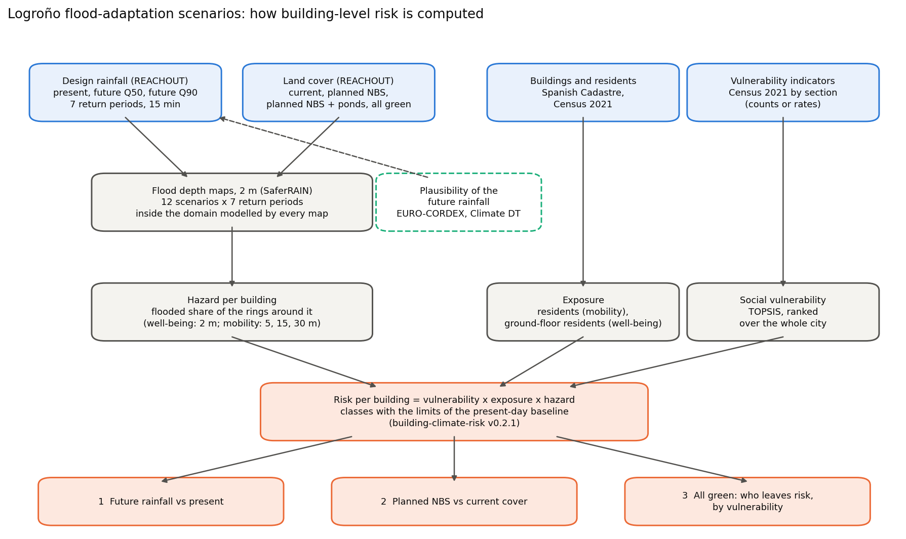

# logrono-flood-adaptation-scenarios

[](https://github.com/annefou/logrono-flood-adaptation-scenarios/actions/workflows/ci.yml)
[](https://annefou.github.io/logrono-flood-adaptation-scenarios/)
[](https://github.com/annefou/logrono-flood-adaptation-scenarios/pkgs/container/logrono-flood-adaptation-scenarios)
[](https://opensource.org/licenses/MIT)
[]({{ZENODO_DOI}})
[](docs/fair4rs-checklist.md)
[](https://forrt.org/)
[](nanopubs/PUBLISHED.md)
[](ro-crate-metadata.json)
[](https://archive.softwareheritage.org/browse/origin/?origin_url=https://github.com/annefou/logrono-flood-adaptation-scenarios)

> **Building-level pluvial flood risk in Logroño (Spain) under future rainfall and nature-based solution scenarios** — the shared analysis behind three FORRT nanopublication chains.
> Method: [Vogelbacher et al. (2026), NHESS](https://doi.org/10.5194/nhess-26-2765-2026) through [building-climate-risk v0.2.1](https://doi.org/10.5281/zenodo.23285504). City inputs: [Logroño replication v0.1.1](https://doi.org/10.5281/zenodo.23285198).

For every residential building in Logroño, risk = social vulnerability × exposure × flood hazard is computed under the [REACHOUT flood scenarios](https://doi.org/10.5281/zenodo.14035876): present and future (EURO-CORDEX median and 90th percentile) 15-minute design storms of seven return periods, combined with four land covers (current green cover, the planned nature-based solutions with and without extra ponds, and all open space green). The future rainfall is checked against the [Destination Earth Climate DT](https://doi.org/10.21957/79c6af3105) projections and storylines over La Rioja.



## Findings

Each finding is a separate, question-rooted FORRT chain in its own repository, built on this analysis's release:

| | Finding | Chain repository |
|---|---|---|
| 1 | Heavier future design rainfall increases the number of residents living in buildings at pluvial flood risk, at every return period; no building moves to a lower risk class. | [logrono-future-rainfall-flood-risk](https://github.com/annefou/logrono-future-rainfall-flood-risk) |
| 2 | REACHOUT's planned nature-based solutions reduce the number of residents at risk by less than 4 %, only for frequent storms; no reduction during the 100- and 200-year storms. | [logrono-planned-nbs-flood-risk](https://github.com/annefou/logrono-planned-nbs-flood-risk) |
| 3 | Converting all open space to green mainly takes less socially vulnerable residents out of risk. | [logrono-greening-flood-risk-vulnerability](https://github.com/annefou/logrono-greening-flood-risk-vulnerability) |

Figures here: [`main_result.png`](figures/main_result.png), [`land_cover_rp100.png`](figures/land_cover_rp100.png), [`priority_map.png`](figures/priority_map.png).

The future rainfall used by REACHOUT is checked in [`rainfall_change.png`](figures/rainfall_change.png): its median scenario is of the same order as the Climate DT; its 90th-percentile scenario lies above every Climate DT central estimate.

These are model scenarios, not predictions: SaferRAIN represents the measures only as infiltration, without storage or sewers; social vulnerability comes from census-section rates and was not validated against impact data. See each notebook and the chains' limitations.

## Pipeline

| Step | Notebook | What it does |
|---|---|---|
| 1 | [`01_data_download`](notebooks/01_data_download.py) | Downloads the Logroño replication release (MD5-checked) and runs its pipeline up to the city inputs |
| 2 | [`02_data_clean`](notebooks/02_data_clean.py) | Records REACHOUT's archive (files, rainfall, defects), finds the domain modelled by every map, polygonises flood depths ≥ 30–100 cm |
| 3 | [`03_analysis`](notebooks/03_analysis.py) | Hazard, vulnerability and risk per building for 82 maps; class transitions; who is affected; recorded impact places |
| 4 | [`04_climate`](notebooks/04_climate.py) | EURO-CORDEX check of REACHOUT's rainfall factors; Climate DT projections and storylines (HEALPix, sphere vs WGS84) |
| 5 | [`05_figures`](notebooks/05_figures.py) | Figures, each checked for overlapping labels (`scripts/figcheck.py`) |

Climate DT data need a DestinE account (see [`scripts/climatedt.py`](scripts/climatedt.py)); without it, step 4 shows the committed results in `results/`.

## Quick start

```bash
git clone https://github.com/annefou/logrono-flood-adaptation-scenarios.git
cd logrono-flood-adaptation-scenarios
pixi install
pixi run snakemake --cores 1
```

Or with Docker: `docker run --rm ghcr.io/annefou/logrono-flood-adaptation-scenarios:latest`. The Jupyter Book is at <https://annefou.github.io/logrono-flood-adaptation-scenarios/>.

## Related nanopublications

- The Logroño replication's FORRT chain (CiTO citation): <https://w3id.org/sciencelive/np/RAoFYugT7OVk5eoHuxKCO9HeqA08jMfSn7TeUxwZcbezE>
- Study area, Logroño (geographic coverage): <https://w3id.org/sciencelive/np/RAzds1z9t2ac7XFvx_Hsv18__p5nUTNA0NHIsskSyLVPQ>
- The three finding chains and their Research Synthesis: listed in [`nanopubs/PUBLISHED.md`](nanopubs/PUBLISHED.md) once published.

## Data and credits

Framework: Vogelbacher, von Szombathely, Lennartz, Poschlod, Sillmann (2026). Flood maps and EURO-CORDEX IDF data: Andrea Staccione, Jeremy S. Pal (REACHOUT, CC BY 4.0). Buildings, parcels, addresses: Dirección General del Catastro. Census: INE. Urban Atlas: EEA / Copernicus Land Monitoring Service. Basemap: Esri. Climate DT: ECMWF and the Climate DT consortium (led by CSC), Destination Earth — *this data is created based on data of the European Union, using the Destination Earth Platform, but has been modified by Anne Fouilloux.*

## Citation

Cite this analysis via [`CITATION.cff`](CITATION.cff) → DOI [{{ZENODO_DOI}}]({{ZENODO_DOI}}), and the method paper [10.5194/nhess-26-2765-2026](https://doi.org/10.5194/nhess-26-2765-2026).

## Built from a template

Created from [`sciencelivehub/forrt-replication-template`](https://github.com/sciencelivehub/forrt-replication-template), part of the [Science Live platform](https://platform.sciencelive4all.org); see [`CLAUDE.md`](CLAUDE.md) for the workflow and [`docs/fair4rs-checklist.md`](docs/fair4rs-checklist.md) for FAIR4RS conformance.
